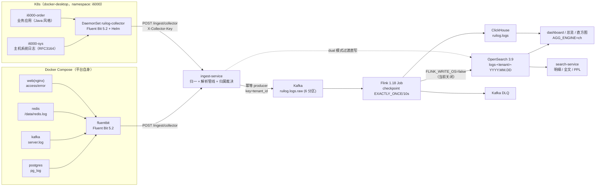

# RuiLog 当前架构与实现现状（2026-11-20 快照）

> 本文记录「采集对象上 K8s、租户改为按业务系统划分」这轮架构调整后的**真实形态**：拓扑、字段契约、写入链路、本轮改动清单、实测状态与尚未解决的问题。
>
> 与设计文档的区别：`docs/tech-stack-selection.md` 讲选型与目标形态，`docs/log-ingestion-model.md` 讲字段契约设计；**本文只写已经跑起来的东西**，所有数字与状态均来自 2026-11-20 11:40（UTC+8）实测。

---

## 一、调整后的总体拓扑



**一句话链路**：两个采集平面把日志统一送到 `ingest-service` 的 `/ingest/collector`，由服务端做归一、解析、租户裁决，再经 Kafka 进入 Flink，落 ClickHouse 做聚合、落 OpenSearch 做明细检索。采集端**不写 tenant_id**。

---

## 二、两层采集平面

### 2.1 K8s 平面（业务日志 + 系统日志）

模拟的 I6000 系统跑在 `docker-desktop` 集群的 `i6000` 命名空间，两个 Deployment 共用该命名空间即共用租户 `i6000`：

| 工作负载 | 模拟内容 | 日志形态 | 节奏 |
|---|---|---|---|
| `i6000-order` | 业务应用（SpringBoot/logback 风格） | `2026-11-20 11:41:58.012  [http-nio-8080-exec-0] WARN c.s.i.order.service.OrderService - order created orderId=... amount=... status=SUCCESS`；每 5 条有 1 条 ERROR 带 7 行 Java 堆栈 | 2s |
| `i6000-sys` | 主机系统日志 | `Nov 20 11:41:37 i6000-node-01 authpriv.warn sshd: Failed password for root from 10.20.30.40 port 51234 ssh2`，6 类事件轮转 | 3s |
| `ruilog-collector` | DaemonSet 采集器（Fluent Bit 5.2） | 采 `/var/log/containers/*_i6000_*.log`，软链经宿主机 `/var/log` 挂载才能读到 | 常驻 |

采集器按 **container 拆 INPUT**，而不是一个大 tail：

- `*_i6000_order-*.log` → `Parser cri` + `Multiline.parser java` + `record_modifier`（`log_class=business`、`source_type=app`）
- `*_i6000_sys-*.log` → `Parser cri` + 单行 + `record_modifier`（`log_class=system`、`source_type=syslog`）

两个 INPUT 都补 `Record host ${NODE_NAME}`（容器日志正文里没有主机概念，靠 `fieldRef spec.nodeName` 注入），并打 `cluster_id`。两个 Pod 均注入 `TZ=Asia/Shanghai`。

部署方式：`deploy/helm/ruilog-collector`（DaemonSet + ConfigMap + Secret），测试系统清单在 `deploy/k8s/i6000-demo/`。

### 2.2 Docker 平面（平台自身组件）

原则是**能采平台自身日志就采自身，采不到才起容器**，所以 Compose 侧只采真实进程：

| 组件 | 日志文件 | 内容 | 当日量 |
|---|---|---|---|
| web（nginx） | `access.log` / `error.log` | 真实接口调用、状态码、上游超时 | 1590 + 39 |
| redis | `/data/redis.log` | RDB/AOF、主从、告警字符 | 3030 |
| kafka | `/bitnami/kafka/server.log` | log4j 格式，启动期配置 dump 需多行合并 | 12305 |
| postgres | `pg_log/*.log` | `log_min_duration_statement=200ms`，只记慢查询与错误 | 494 |

`fluentbit/conf.d` 按类型拆分，`30-middleware.conf`、`40-database.conf` 生效；`10-business.conf`、`20-system.conf` **已停用**（业务/系统日志已迁到 K8s，Docker 侧再采会形成双来源、双租户分裂）。

---

## 三、字段契约与租户归属

### 3.1 归一层（`ingest-service/app/log_schema.py`）

- 事件时间按 `TIME_KEYS`（`date` / `event_time` / `@timestamp` / `time`）识别并归一化成 UTC ISO 毫秒 `Z`。Fluent Bit 5.2 的 JSON 输出把时间放在 `date`（epoch 秒），不认它会全退化成采集时刻。
- `build_message()` 兜底顺序：`message` → `request` → **`log`（CRI 正文）** → `raw`。K8s 采集端只搬原文，正文就在 `log` 里。
- `normalize_level()` 无任何线索时返回 **UNKNOWN**，绝不兜底 INFO。

### 3.2 服务端解析管线（`pipeline.py` + `pipeline_store.py`）

`PIPELINE_MODE=active` 是默认值且是 K8s 场景的**必要配置**：采集端不抽字段，`level / source / host / message` 全靠管线。当前播种两条规则：

| 解析器 | 管线 | 作用域 | 抽取 |
|---|---|---|---|
| `java-logback` | `java-logback-business` | `log_class=business` + `source_type=app` | 时间、level、logger→source、thread→`attrs.thread`、message |
| `syslog-rfc3164` | `syslog-system` | `log_class=system` + `source_type=syslog` | 时间、host、facility+severity→level、program→source、message |

规则改完 30 秒内全集群生效（`PIPELINE_CACHE_TTL`）。未匹配的记录保留原文并标 `parse_status=unmatched`，不丢弃——否则"配了没生效"无从发现。

### 3.3 租户归属（`derive_tenant()`）

**四级判定，判不出就拒收**：

1. 显式 `tenant_id`（App 直报 / API 调用）
2. `hosts` 台账按 host 查（系统、中间件、数据库日志走这条，等价于 CMDB）
3. `namespace_tenant` 表按 `src_file` 里的命名空间匹配（K8s 容器日志：`..._i6000_order-xxx.log` → `i6000`）
4. 都匹配不上 → **HTTP 拒收并返回原因**，不再落 `logs-unknown`

租户唯一真源是 PG 的 `tenants` 表（当前两个：`i6000`、`log-system`），索引名约定 `logs-<code>-YYYY.MM.DD`。

---

## 四、写入与查询

### 4.1 写入

```
采集端 → ingest（归一/解析/裁决）
        ├─ INGEST_STORAGE_MODE=dual：直写 OS
        └─ confluent-kafka 幂等 producer（acks=all，key=tenant_id）→ ruilog.logs.raw
                → Flink DataStream Job（checkpoint EXACTLY_ONCE / 10s）
                        ├─ ClickHouse ruilog.logs（ReplacingMergeTree(ver)，event_id 幂等）
                        ├─ OpenSearch（FLINK_WRITE_OS=false，当前关闭）
                        └─ 失败进 DLQ
```

- 自研 sink 把**刷盘绑到 checkpoint**（`CheckpointedFunction.snapshotState()` 强制 flush + `FLINK_SINK_FLUSH_MS=5000` 时间兜底），避免低流量租户数据滞留内存。
- 稳态目标是 `INGEST_STORAGE_MODE=kafka` + `FLINK_WRITE_OS=true`（Flink 统一写两引擎），当前 `dual` 是过渡态。

### 4.2 查询分工（铁律）

| 场景 | 引擎 | 原因 |
|---|---|---|
| 明细列表、全文检索、PPL、上下文 | **OpenSearch** | PPL 是 OpenSearch 专属插件，ClickHouse 不支持 |
| 总览 KPI、仪表盘图表、直方图 | **ClickHouse**（`AGG_ENGINE=ch`） | 列式存储，固定维度聚合快 |
| 检索耗时洞察 `top_queries-*` | **OpenSearch**（insights 自产） | 与检索侧同源 |

ClickHouse 失败自动回退 OpenSearch。`dashboard-service/app/ch_client.py` 的 `terms_on()` 对未知字段**抛异常回退**，绝不静默替换成 `level`。

### 4.3 多租户与权限

- 5 个业务服务（search / dashboard / alarm / ingest / system）各自 `authz.py`，按 JWT 强制解析租户，前端传值仅作意图。
- 租户级资产：日志索引物理隔离、`dashboards.tenant`、`alarm_rules.tenant`（`'all'` 为平台级通用规则，普通账号只读）、数据源配置。
- PPL 租户维度按范围分别处理：单租户范围主动剥离 `tenant*` 谓词（索引已隔离，写进去只会恒 0 条）；跨租户范围（`all`，仅管理员）**允许**虚拟字段 `tenant` 分组与过滤，由网关翻译成物理 `tenant_id` 并回译中文名。

---

## 五、本轮架构调整清单

| # | 调整项 | 调整前 | 调整后 |
|---|---|---|---|
| 1 | 租户划分依据 | 按模拟租户 `default/acme/gp`，正文写 `tenant=` | 按业务系统：K8s namespace `i6000` + 平台自身 `log-system`；正文不带租户 |
| 2 | 业务日志来源 | Docker `log-generator` 写共享卷 | K8s `i6000-order`，DaemonSet 采容器日志 |
| 3 | 系统日志来源 | Docker `sys-sim`（alpine + busybox syslogd） | K8s `i6000-sys`；`sys-sim` 服务已从 compose 删除 |
| 4 | 采集配置形态 | 单容器 + `conf.d` 多文件 | 双层：K8s Helm DaemonSet（按 container 拆 INPUT）+ Compose Fluent Bit（按组件拆 conf） |
| 5 | 字段抽取位置 | 采集端正则直接抽 level/source | 采集端只搬 CRI 原文，**服务端解析管线**抽；`PIPELINE_MODE` 默认改 `active` |
| 6 | 归属判定 | `tenant_id > src_file > logs-unknown` | `tenant_id > hosts 台账 > namespace_tenant > **拒收**`，取消 unknown 兜底桶 |
| 7 | `log-generator` | 默认启动 | `profiles: ["legacy-docker"]`，默认不启，租户名改 `i6000` |
| 8 | 索引字段 | 只有 `message/raw`，CRI `log` 未声明 | 模板显式声明 `log(text)/stream/logtag` |
| 9 | 时间语义 | 正文时间映射进 `@timestamp` | `@timestamp` 只取 CRI 时间（带时区）；正文时间进 `attrs.body_ts`；Pod 注入 `TZ=Asia/Shanghai` |
| 10 | 容器主机维度 | 无 | DaemonSet 注入 `NODE_NAME`，`Record host ${NODE_NAME}` |

---

## 六、当前实现状态（2026-11-20 11:40 实测）

### 6.1 运行实例

- **Docker**：18 个容器 running —— postgres / opensearch / opensearch-dashboards / redis / clickhouse / kafka / flink-jobmanager / flink-taskmanager / web / fluentbit + 8 个 FastAPI 服务（auth、search、dashboard、alarm、ingest、agent、system-service、ai）。
- **K8s**：`i6000-order`、`i6000-sys` 两个 Pod Running，`ruilog-collector` DaemonSet 1/1 Ready。
- **Flink**：Job RUNNING，checkpoint 正常。

### 6.2 数据量

| 存储 | 索引 / 表 | 文档数 | 体积 |
|---|---|---|---|
| OpenSearch | `logs-i6000-2026.11.20` | 4828 | 2.2 MB |
| OpenSearch | `logs-log-system-2026.11.20` | 18120 | 3.7 MB |
| ClickHouse | `i6000` / business | 2875 | — |
| ClickHouse | `i6000` / system | 1749 | — |
| ClickHouse | `log-system` / middleware | 10010 | — |
| ClickHouse | `log-system` / database | 287 | — |

### 6.3 解析质量（`logs-i6000` 近 15 分钟）

```
级别      INFO 420 / WARN 188 / ERROR 139 / UNKNOWN 89
分类      business 537 / system 299
解析状态  parsed 747 / unmatched 89
```

- `UNKNOWN` 与 `unmatched` 数量完全一致，都是 Java 异常栈里的**裸续行/异常首行**（无时间戳前缀，不属任何规则的作用域），不是解析器失配。
- ClickHouse 侧仍有较多 UNKNOWN，是**管线切 active 之前**写入的历史行，不做回补（历史数据不猜分类、不猜级别）。

### 6.4 各页面实测

| 页面 | 状态 | 说明 |
|---|---|---|
| 日志分析（i6000） | 正常 | 全文命中、级别/来源/主机齐全 |
| 运行总览 | 正常 | 4 指标卡 + 4 图取自真实聚合 |
| 仪表盘 | 正常 | 级别/来源/主机/分类四类维度均可聚合 |
| 告警事件 | 正常 | 10 条规则，实测触发：全量 ERROR、认证失败激增 |
| 数据源 | 正常 | 自动发现 6 个来源（OrderService / sshd / CROND / i6000-agent / kernel / systemd） |
| 解析规则 | 正常 | `/api/pipelines/*` 路由已对齐，返回 401（未登录）而非 404 |
| 租户配额 | 正常 | i6000 与 log-system 文档数按 `index_tenant()` 归集 |

---

## 七、本轮修掉的问题与根因

| 现象 | 根因 | 修法 |
|---|---|---|
| I6000 检索看不到日志正文 | 三重叠加：模板未声明 `log` 字段（`dynamic:false` 下只存不索引）+ `build_message` 不认 `log` + 管线 shadow 模式不回填 | 模板加字段并对存量索引 PUT `_mapping`；`build_message` 增加 `log` 兜底；`PIPELINE_MODE=active` |
| 仪表盘无数据 | 聚合维度 `level/source/host` 全为 UNKNOWN 或空 | 随上一条一并修复 |
| 告警事件无数据 | 规则写死 `source_type=auth`（旧采集端分类），K8s 侧统一为 `syslog`；且级别全 UNKNOWN | 规则改按 `match_log_class=system` 圈定；管线回填级别后判定恢复 |
| 数据源无数据 | 自动发现依赖 `source` 字段 terms 聚合，该字段为空 | 管线抽取 logger/program → `source` |
| 解析规则页报错 | nginx 把 `/api/pipelines/status` 重写成 `/status`，而 ingest 路由挂在 `/pipelines` 前缀下 → 全 404 | rewrite 只剥 `/api` |
| 租户配额文档数恒 0 | 直接切 `logs-` 前缀得到 `i6000-2026.11.20`，永不对上租户码 | 用 `storage.index_tenant()` 归一索引名 |
| 解析规则"配了没生效" | `init_db` 里 `LIKE '%-sim'` 的裸 `%` 被 psycopg2 当占位符，抛 `tuple index out of range` 中断整个初始化，规则播种被静默跳过 | SQL 参数化；`except` 改为打印完整堆栈 |
| 异常栈与 ERROR 头行拆成两条 | java 多行规则只有 `^\s+at ` 等续行，未覆盖"无缩进异常类名"首行 | 补规则后 7 行堆栈合并为 1 条（表头仍单独成条，见遗留） |

---

## 八、尚未解决 / 后续演进

### 8.1 已知问题

1. **Java 异常首行与 ERROR 表头仍分两条**。已在最小 Fluent Bit 5.2 环境复现：multiline **filter** 不会把 `start_state`（带时间戳的表头）与随后 `cont` 行合并；同样规则在 Docker 侧走 INPUT 级 `Multiline.parser` 可合并，但 K8s 走 INPUT 级会先匹配 CRI 原始前缀而不生效。彻底解二选一：应用侧输出 JSON 单行结构化，或服务端按 `时间 + src_file` 归并。
2. **按类名片段搜不到**：`java.lang.NullPointerException` 被标准分词器当作单个 token，搜 `NullPointerException` 0 命中，搜 `cannot invoke method` 有 221 条。需给 `log/message` 配 `word_delimiter` 分析器并重建索引。
3. **历史数据灰区**：管线切 active 之前的行 level 为 UNKNOWN，按治理原则不猜测回补；如需修正应作为单独的数据治理动作。
4. **`docker compose up -d` 未在此轮执行**：compose 的结构性变更（删 `sys-sim`、`log-generator` 转 profile）需下次 `up` 才落到容器层；`sys-sim` 早已退出、`log-generator` 已手动停掉，不影响当前链路。

### 8.2 演进方向

- 告警判定从"请求时对 OS/CH 聚合"迁到 Flink 窗口算子（真流上判定）。
- `INGEST_STORAGE_MODE` 切 `kafka` + `FLINK_WRITE_OS=true`，收敛为 Flink 统一写双引擎。
- 容器日志多行结构化前移到应用侧（推荐 logback JSON encoder），从根上消除分帧问题。
- 未租户化残留：agent 主机配置、AI 模型配置、saved-views（仍 stub，落地需按"租户 + 用户"存）。

---

## 九、关键约束速查（改代码前先看）

1. **`log` 字段必须留在索引模板里**，删掉容器日志立即不可检索。
2. **`PIPELINE_MODE` 默认必须是 `active`**，shadow 的表现是"有日志但页面全空"。
3. **`@timestamp` 只取 CRI 时间**，正文时间进 `attrs.body_ts`；正文时间无时区，映射进去会整体偏 8 小时并产生"未来时间"脏数据。
4. **租户判不出必须拒收**，不要恢复 `unknown` 兜底桶。
5. **`init_db` 的 SQL 不许出现裸 `%`**，`pg_exec` 用空 tuple 调 `cursor.execute`。
6. **`terms_on()` 未知字段必须抛异常回退 OS**，不能 `else: field="level"`。
7. **OS `terms` 聚合默认丢缺字段文档**，分类维度要显式 `"missing": ""`。
8. **`attrs` 用 `flat_object`**（OpenSearch 无 `flattened`，用它会 400）。
9. **nginx `/api/pipelines/` 只剥 `/api`**，与 `api_pipelines.router` 的 `prefix="/pipelines"` 对齐。
10. **多行规则里块首只能放 `start_state`**，`cont` 只认块内其余行，放错会多块粘连。

---

## 十、复现与验收

```bash
# 1. 链路是否通：看采集器回执
kubectl logs -n ruilog-system ds/ruilog-collector --tail=20

# 2. 解析是否正确（最近 5 分钟）
curl -s -u admin:admin -H 'Content-Type: application/json' \
  "http://localhost:9200/logs-i6000/_search?size=5&sort=@timestamp:desc" \
  -d '{"query":{"range":{"@timestamp":{"gte":"now-5m"}}}}' | python3 -m json.tool | head -60

# 3. 级别/分类分布（应为 INFO/WARN/ERROR 有值，log_class 分 business/system）
curl -s -u admin:admin -H 'Content-Type: application/json' \
  "http://localhost:9200/logs-i6000/_search" \
  -d '{"size":0,"query":{"range":{"@timestamp":{"gte":"now-1h"}}},
       "aggs":{"lv":{"terms":{"field":"level"}},"cls":{"terms":{"field":"log_class"}}}}'

# 4. 双引擎是否一致
docker exec log_system-clickhouse-1 clickhouse-client \
  -q "SELECT tenant_id, log_class, count() FROM ruilog.logs WHERE ts > now() - INTERVAL 1 HOUR GROUP BY 1,2"
```

---

_最后更新：2026-11-20 11:45（UTC+8），对应分支 `feat/ingestion-pipeline`。_
